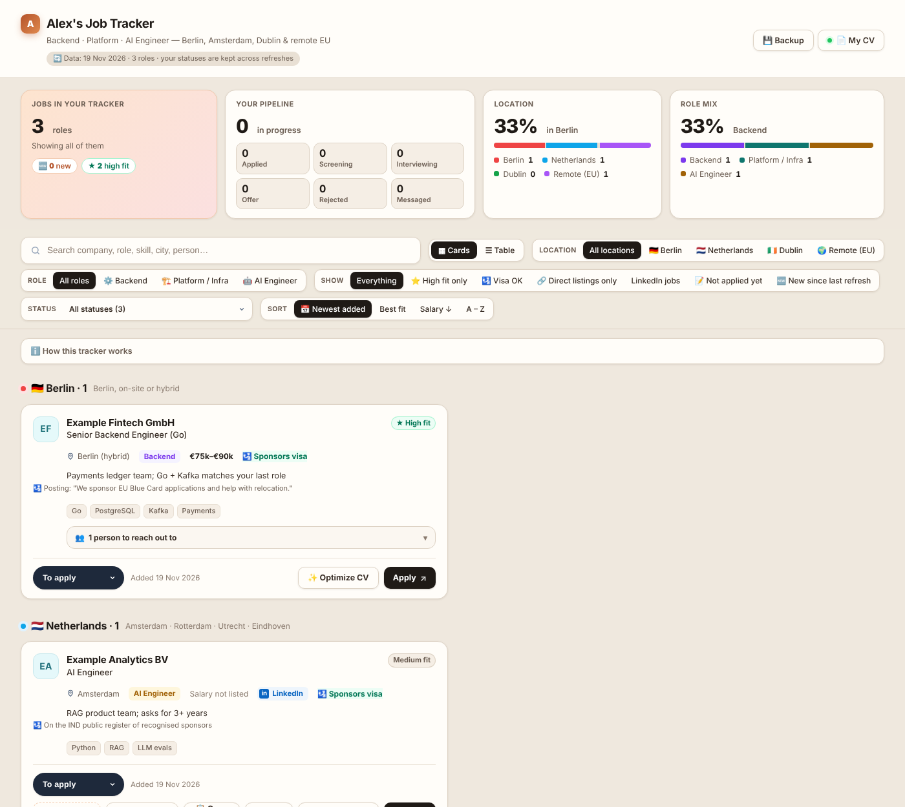

# Next Move

**Your CV, your countries, your rules — a job search your own Claude runs for you.**

Next Move is a personal job tracker that **pulls roles matching your CV, in the countries you choose — whether you already have the right to work there or need visa sponsorship** — and keeps everything in one page you open in your browser.

Your own Claude session does the searching. This repo gives it the rules, scripts and page template,
so the results are consistent and nothing about your search is hard-coded: roles, cities, countries,
visa needs, salary floor, languages and tone all come from your `profile.yaml`.



## What you get

- **A tracker page** (one HTML file): roles grouped by your locations, filters by role type, fit, visa and status, a pipeline dashboard, and statuses that survive every refresh. Cards and table view.
- **Pulls that match you**: LinkedIn (signed-in browser or public search), the career boards of companies you like *and* of every company already in your tracker, and the main job boards of each country you target.
- **Visa-aware filtering**: for each country you mark as needing sponsorship, a role is added only with evidence — the posting's own words, or the employer on the country's official sponsor register (the UK register is checked automatically).
- **Answers to each job's application questions**, ready under 📝 Answers: routine facts (location, right to work, notice, salary) taken word for word from your profile, and short, specific "why us / why this role" answers backed by real numbers from your CV. A checker blocks invented numbers or skills and flags generic, AI-sounding wording.
- **A one-page tailored CV per job**, as a PDF, built only from facts in your CV. Invented numbers or skills are rejected by a checker, and skills you list as "ask first" are never claimed without you.
- **People to reach out to** for each role (names and public profile links; Claude never messages anyone), plus a ready outreach message and a ≤280-character connection note in your voice.
- **An Excel copy** (Jobs, People, Portals, Summary) if you want one. Claude only ever adds rows.

## Get started (5 minutes)

You need: [Claude Code](https://claude.com/claude-code) or the Claude desktop app with a folder connected, and Python 3.9+.

```bash
git clone https://github.com/<you>/next-move.git
cd next-move
pip install -r requirements.txt
```

Then open the folder in Claude and say:

> **Set up my job tracker.** Here's my CV. *(attach it)*

Claude reads your CV, asks a few questions (roles, cities/countries, where you need visa sponsorship,
salary, languages, dream companies, how your messages should sound), writes `me/profile.yaml` and
`me/cv.json`, and builds your page. Then:

> **Pull latest jobs.**

Every later pull only adds what's new since the last one. Your statuses, notes and messaged-ticks
are never reset.

### Make it automatic

Ask Claude to *"set up a scheduled task to pull my jobs every weekday morning"*. It uses this prompt:

> In the next-move repo at `<path>`: read CLAUDE.md, then run the job-tracker-refresh skill for me.
> Use my profile in me/. Don't apply or message anyone. Finish with the short report.

## Your data

Everything personal lives in `me/`, which is **git-ignored** — your CV, profile, jobs and notes never
get committed. To keep a private backup, put `me/` in its own private repo or cloud folder.

| File | Purpose |
|---|---|
| `me/profile.yaml` | What you're looking for and how Claude should work for you ([commented example](examples/profile.example.yaml)) |
| `me/cv.json` | Your base CV, structured ([example](examples/cv.example.json)) |
| `me/jobs.json` | All tracked roles ([example](examples/jobs.example.json)) |
| `me/notes.md` | Interviews, recruiter notes, open questions ([example](examples/notes.example.md)) |

Statuses you set in the page are saved in that browser. Use **💾 Backup** in the page to copy them
somewhere safe or move them to another browser.

## Countries

Country packs in [`countries/`](countries/) hold each country's work-visa route, official sponsor
register (and how to check it) and main job boards: UK, IE, DE, NL, FR, US, CA, AU, SG, AE, IN and
remote-EU. Missing yours? Ask Claude to *"add a country pack for Portugal"* — and send a PR.

## Common things to ask Claude

- "Pull latest jobs" · "Add this job: <link>" · "Tailor my CV for the Acme role" · "Write answers for the Acme application"
- "Also look in Amsterdam" · "I now have the right to work in Ireland" · "Skip agency posts from X"
- "What follow-ups are due?" · "Regenerate tailored CVs for jobs I haven't applied to"

## How it works

```
profile.yaml + cv.json ──► search_jobs.py / browser / web search ──► candidates
                                                                        │  Claude reads each posting:
                                                                        │  fit, years, language, salary, visa evidence
                                                                        ▼
                       jobs.py add (dedupe, stable IDs, visa gate) ──► jobs.json
                                                                        │
           tailor_cv.py (fact check, one page) ──► Tailored CVs/<Company>/…pdf
           answers.py (truth + quality check)  ──► 📝 Answers on each job
                                                                        │
                    build.py ──► <Name>_Job_Tracker.html     sync_xlsx.py ──► Job_Tracker.xlsx
```

Scripts (all `--help`-documented): `build.py`, `jobs.py`, `search_jobs.py`, `fetch_posting.py`,
`check_sponsor.py`, `tailor_cv.py`, `answers.py`, `cv_pdf.py`, `sync_xlsx.py`, `import_legacy.py`. Claude's
instructions are in [`CLAUDE.md`](CLAUDE.md) and [`.claude/skills/`](.claude/skills/).

Try the demo without any setup: `python scripts/build.py --example` and open `examples/Example_Job_Tracker.html`.

### Network access

The scripts call LinkedIn's public job search, the Ashby / Greenhouse / Lever / Workable public job
APIs and gov.uk. If Claude runs in a sandbox that blocks them, it falls back to a browser or web
search. To let the scripts run, allow: `www.linkedin.com`, `api.ashbyhq.com`, `boards-api.greenhouse.io`,
`api.lever.co`, `apply.workable.com`, `www.gov.uk`, `assets.publishing.service.gov.uk`.

## Ground rules Claude follows

Never invents facts on a CV or job record · never applies, messages or connects for you · never types
your passwords · never deletes your jobs or overwrites your edits · asks before deleting files · respects
LinkedIn by browsing slowly. See [`CLAUDE.md`](CLAUDE.md).

## Contributing

Country packs, ATS sources and template improvements are welcome. Run `python tests/test_scripts.py`
before sending a PR. Don't commit anything from `me/`.

MIT licence.
